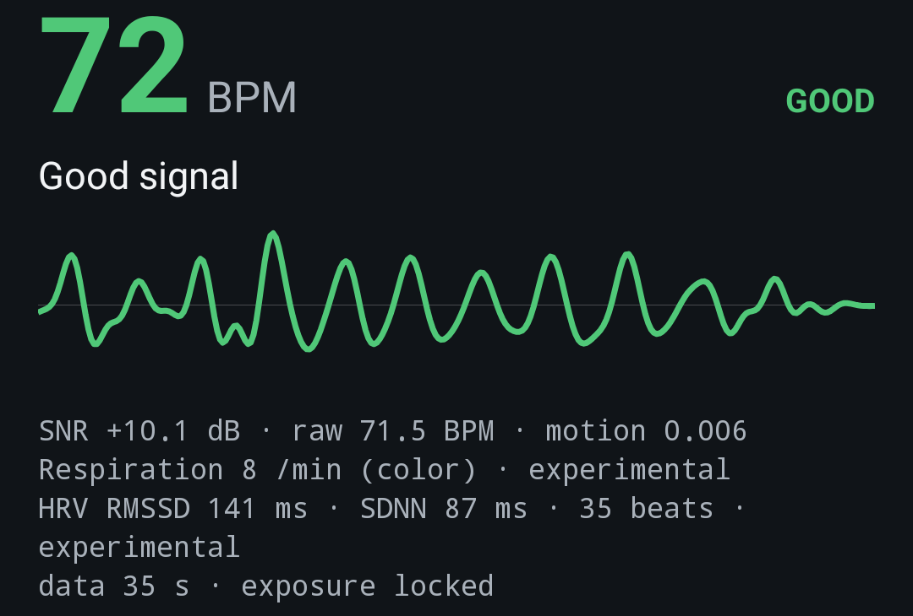
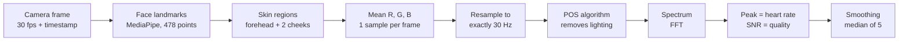
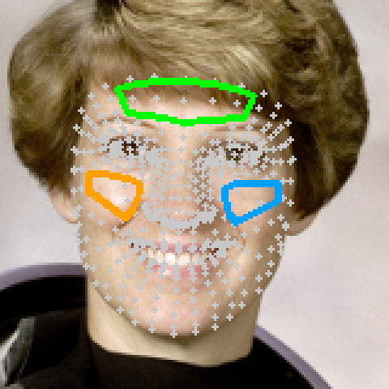
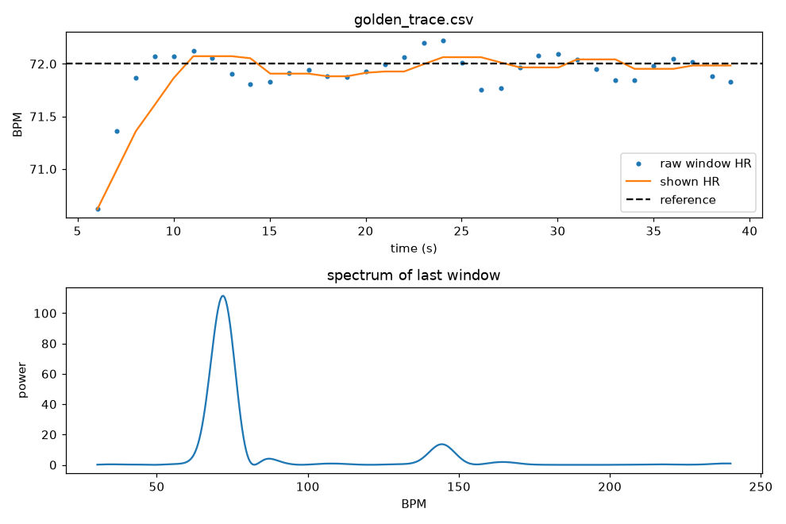

<p align="center">
  
</p>

<h1 align="center">rPPG Vitals</h1>

<p align="center">
  Contact-free heart rate from a phone camera — an Android app and a Python reference implementation.<br>
  Everything runs on the device. No video leaves the phone.
</p>

<p align="center">
  
</p>

> **Not a medical device.** This is a learning / portfolio project. Do not use it for medical decisions.

---

## What it does

Point the front camera at your face. Within about 10 seconds the app shows:

| Output | Status |
|---|---|
| **Heart rate (BPM)** with a live pulse waveform | core feature |
| **Signal quality** (good / fair / poor / moving / no face) with guidance text | core feature |
| Respiration rate (breaths per minute) | experimental |
| Heart-rate variability (RMSSD, SDNN) | experimental |
| Session recording to CSV (for offline analysis in Python) | tool |

The Android app (Kotlin) and the Python code use **the same algorithm**. Python is the reference;
a "golden file" unit test checks that Kotlin reproduces the Python numbers.

---

## How camera-based heart rate (rPPG) works

**rPPG** = *remote photoplethysmography*. Photoplethysmography (PPG) is what a pulse oximeter or a
smartwatch does: shine light into the skin and measure how much comes back. "Remote" means we do it
with an ordinary camera and room light, from a distance.

### 1. The physical signal

Every heartbeat pushes a wave of blood into the small vessels of the skin. Blood absorbs light —
especially **green** light — so with each beat the skin becomes *very slightly* darker, then lighter again.

The change is tiny: roughly **0.1–1 % of the pixel brightness**, invisible to the eye and smaller than
camera noise in a single pixel. Two tricks make it measurable:

- **Average many skin pixels.** Noise is random per pixel and cancels out; the pulse is the same in
  every skin pixel and survives. Averaging ~5,000 pixels reduces noise about 70×.
- **Look at many frames over time.** The pulse is periodic (about 1–2 times per second), so it
  appears as a clear peak in the frequency spectrum.

### 2. The pipeline



**Step by step:**

1. **Capture.** Front camera at a fixed 30 fps (640×480 is enough). On Android the app **locks
   auto-exposure and auto-white-balance** two seconds after it finds a face: if the camera changes
   brightness during the measurement, that jump is thousands of times larger than the pulse.

2. **Find the face.** [MediaPipe Face Landmarker](https://ai.google.dev/edge/mediapipe/solutions/vision/face_landmarker)
   returns 478 points on the face for every frame.

3. **Choose skin regions (ROIs).** The forehead and both cheeks have thin skin, many blood vessels and
   little movement when talking. Each region is the convex hull of a fixed set of landmarks, shrunk by
   15 % to stay away from hair, eyebrows and edges. Because the regions follow the landmarks, they move
   with the face.

   

   *Regions drawn on the public-domain NASA astronaut test photo (`python/tools/draw_rois.py`).*

4. **Average the colour.** For each frame, compute the mean red, green and blue value of all pixels
   inside the regions. The video becomes three numbers per frame: `R(t), G(t), B(t)`.

5. **Resample.** Real cameras do not deliver frames at exactly 30 fps and sometimes drop frames.
   Using the real timestamps, the signal is interpolated onto an exact 30 Hz grid. Assuming a
   fixed frame rate would shift the measured frequency.

6. **Separate pulse from lighting — the POS algorithm.** The green channel alone works only in perfect
   conditions: any change of lighting or a small head movement also changes the brightness, often
   more than the pulse. **POS** (*Plane-Orthogonal-to-Skin*, Wang et al. 2017) uses all three colours.
   For every short window (1.6 s):

   - divide each colour by its mean in the window → removes the overall light level and skin tone;
   - project onto two colour axes chosen so that a **brightness change has no effect** on them:

     $$S_1 = G - B, \qquad S_2 = -2R + G + B$$

   - combine them so the remaining distortion cancels:

     $$h = S_1 + \frac{\sigma(S_1)}{\sigma(S_2)}\, S_2$$

   - add the windows together (overlap-add) into one continuous **pulse signal**.

   Why it works: after the normalisation, a change of light intensity moves all three colours by the
   same amount — the direction (1, 1, 1). Both projection axes are perpendicular to it
   (0 + 1 − 1 = 0 and −2 + 1 + 1 = 0), so brightness changes vanish. The blood-volume change has a
   different colour "signature" (strongest in green) and survives the projection. The unit tests show this directly: with a
   flickering light the green channel reports the flicker frequency, while POS reports the pulse.

7. **Find the heart rate.** Take the last **10 seconds** of the pulse signal, remove the linear trend,
   apply a Hann window and compute the power spectrum with an FFT. The highest **true peak** between
   **0.7 and 3.0 Hz** (42–180 BPM) is the heart rate:

   $$\text{BPM} = f_{\text{peak}} \times 60$$

   The peak position is refined between FFT bins with parabolic interpolation.

8. **Measure quality.** The **signal-to-noise ratio (SNR)** compares the power near the peak (and its
   first harmonic) with the power everywhere else in the band (de Haan & Jeanne 2013). A clean pulse
   gives > +3 dB ("good"); below 0 dB the value is hidden ("poor"). The app also tracks how much the
   face moves; strong motion is flagged as "moving".

9. **Smooth.** The displayed value is the median of the last 5 accepted per-second estimates, so a
   single bad window does not make the number jump.

### 3. Extras (experimental)

- **Respiration.** Breathing slightly moves the head and modulates the skin colour at 0.1–0.5 Hz
  (6–30 breaths/min). The app looks for the strongest peak in that band over 30 s, both in the vertical
  face motion and in the colour signal, and reports the clearer one.
- **HRV.** The pulse signal is band-passed around the current heart rate, individual beats are detected
  as peaks, and the beat-to-beat intervals give **RMSSD** and **SDNN**. At 30 fps one frame is 33 ms,
  so beat timing is coarse — treat these numbers as rough.

### 4. When it fails

| Situation | Why | What the app does |
|---|---|---|
| Head motion, talking | moving shadows and skin are larger than the pulse | motion check → "Hold still" |
| Dim light or backlight | pulse amplitude falls below camera noise | low SNR → "Weak signal" |
| Camera auto-exposure | brightness jumps | exposure/white-balance lock |
| Beard, bangs, glasses | fewer skin pixels | three regions, shrunk away from edges |
| Darker skin tones | melanin absorbs more light → weaker signal | POS normalises per colour; results should be validated per skin tone |
| Very short measurement | 10 s window → 0.1 Hz (6 BPM) spectral resolution | first value only after 6 s, smoothing |

---

## Results

| Test | Result |
|---|---|
| Synthetic signal with known 72 BPM (noise, lighting drift, frame jitter, dropped frames) | MAE 0.15 BPM |
| Synthetic face video (real photo + hidden 72 BPM colour change) through the full pipeline | 72 ± 2 BPM |
| Kotlin vs Python on the same input (golden test) | identical within 0.001 BPM |
| Galaxy A36, Android 16, indoor light | 29.9 fps, face landmarks 27 ms/frame, ~72 BPM, SNR +4 to +10 dB |

The phone result has **not yet been compared against a reference device** (pulse oximeter or smartwatch).
Use `Record` in the app while wearing one, then run `analyze_csv.py --reference-bpm <value>` to get the error.



---

## Project structure

```
android/                Android app (Kotlin, CameraX, MediaPipe Tasks)
  app/src/main/java/com/rppg/vitals/
    core/               algorithm: Dsp, Fft, RppgProcessor, FaceRoi, RppgConfig (pure Kotlin, unit-tested)
    camera/             FrameAnalyzer: camera frame -> landmarks -> ROI colour -> processor
    ui/                 overlay (regions on the preview) and waveform views
python/
  rppg/                 reference implementation (config, dsp, processor, face_roi, session_io, synthetic)
  live_demo.py          webcam demo
  analyze_csv.py        replay a recorded session from the laptop or the phone
  tools/                model download, ROI check image, golden-file generator
  tests/                pytest suite
scripts/                portable Android toolchain setup and build/install helper (Windows PowerShell)
models/                 face_landmarker.task (downloaded, not in git)
```

---

## Quick start

### Python (laptop webcam)

```powershell
python -m venv .venv
.venv\Scripts\python -m pip install -r python\requirements.txt
.venv\Scripts\python python\tools\download_model.py
.venv\Scripts\python -m pytest
.venv\Scripts\python python\live_demo.py          # q = quit, s = record CSV, r = reset
```

### Android

Requirements: Android 8.0+ phone with a front camera, USB debugging enabled.
With Android Studio: open the `android/` folder and press Run (the model must be downloaded first,
see above — the build copies it from `models/`).

Without Android Studio (Windows, portable tools in `C:\dev\tools`, you accept the Android SDK license):

```powershell
powershell -ExecutionPolicy Bypass -File scripts\setup_android_tools.ps1 -AcceptAndroidSdkLicense
powershell -ExecutionPolicy Bypass -File scripts\android.ps1 test       # unit tests
powershell -ExecutionPolicy Bypass -File scripts\android.ps1 install    # build, install, start
powershell -ExecutionPolicy Bypass -File scripts\android.ps1 pull       # copy recorded CSVs to data\phone_sessions
```

Samsung phones: if installation is blocked, turn off **Settings → Security and privacy → Auto Blocker**
while installing, then turn it back on.

**Using the app:** sit still 30–50 cm from the phone with even light on your face and wait ~10 s.
Buttons: **Reset** restarts the measurement · **Lock** toggles the automatic exposure lock ·
**Record** saves a CSV · **Share CSV** sends it.

---

## Keeping Python and Android in sync

The Python code is the reference. After changing `python/rppg/dsp.py` or `processor.py`:

```powershell
.venv\Scripts\python python\tools\make_golden.py        # writes android/app/src/test/resources/golden_*
powershell -ExecutionPolicy Bypass -File scripts\android.ps1 test
```

---

## Privacy

The app requests only the **camera** permission. Network permissions added by libraries are removed
in the manifest, so the app cannot send data anywhere. Frames are processed in memory and discarded;
a recording contains only per-frame average colours and face position, not images.

---

## References

- Verkruysse, Svaasand, Nelson (2008). *Remote plethysmographic imaging using ambient light.* Optics Express.
- de Haan, Jeanne (2013). *Robust pulse rate from chrominance-based rPPG.* IEEE Trans. Biomedical Engineering.
- Wang, den Brinker, Stuijk, de Haan (2017). *Algorithmic principles of remote PPG.* IEEE Trans. Biomedical Engineering. (POS)
- Liu et al. (2023). *rPPG-Toolbox: Deep Remote PPG Toolbox.* NeurIPS Datasets and Benchmarks. https://github.com/ubicomp-lab/rPPG-Toolbox
- Google MediaPipe Face Landmarker. https://ai.google.dev/edge/mediapipe/solutions/vision/face_landmarker
